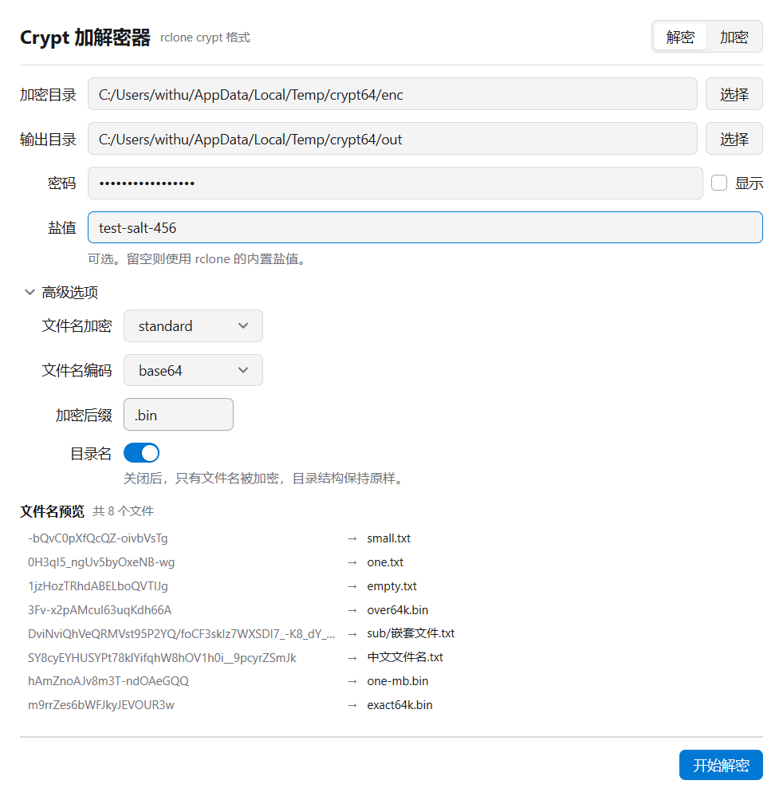
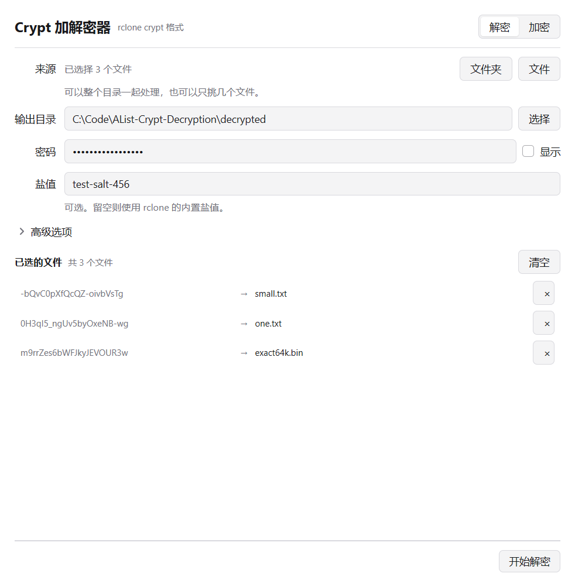

# Crypt 加解密器

按 [rclone crypt](https://rclone.org/crypt/) 的格式加解密文件，兼容 Alist / OpenList 的 Crypt 存储。
Go + [MyGo](https://github.com/egoist/mygo) 原生界面，**单个可执行文件，不需要 Python，也不需要装 rclone**。



## 能做什么

- **解密**：把 Crypt 存储里的文件还原成明文，文件名和目录结构一并还原
- **加密**：把普通文件加密成 rclone crypt 格式，可以直接放进 Crypt 存储用

两个方向用的是同一套参数，所以「加密 → 解密」和「rclone 加密 → 这里解密」都能对上。

## 特点

**内嵌实现，零外部依赖**。scrypt 密钥派生、NaCl secretbox 分块加解密、AES-EME 文件名加解密
全部用 Go 实现，不调用 rclone。支持 rclone crypt 的全部配置组合：

| 配置项 | 支持的值 |
|---|---|
| 文件名加密 | `off` / `standard` / `obfuscate` |
| 文件名编码 | `base64` / `base32` / `base32768` |
| 目录名加密 | 开 / 关 |
| 盐值 | 自定义 / 留空用内置默认盐 |
| 加密后缀 | 任意（仅 `off` 模式生效） |

**先看结果，再动手**。填完密码立刻列出文件名会变成什么。密码或编码填错时一眼就能看出来，
不用等整批跑完才发现解出来全是乱码。

**整个目录，或者只挑几个文件**。点「文件夹」处理一整个目录，点「文件」只选你要的那几个，
可以分多次追加，也能随时移除。选中几个文件时就是这样：



**默认在当前文件夹干活**。把程序丢进一堆文件里，双击打开就已经选好了目录，
输出默认写到旁边的 `decrypted/` 或 `encrypted/`。

**多核并行、可取消、进度可见**，自动跳过 `.git`、`node_modules` 这类目录。

## 使用方法

1. 从 [Releases](../../releases) 下载可执行文件，**不需要安装**，双击就能用
2. 顶部选「解密」或「加密」
3. 选来源：
   - 「文件夹」处理整个目录
   - 「文件」只挑几个文件，可以多次追加；每行右侧的 × 移除单个，右上角「清空」回到目录模式
4. 填写密码；存储端如果设了盐值，一并填入
5. 看预览里显示的文件名对不对。不对就展开「高级选项」，把文件名加密方式和编码调成与存储端一致
6. 点「开始解密」或「开始加密」

手动选的文件会平铺到输出目录，不保留原来的目录层级；不同目录里的同名文件会自动加序号，不会互相覆盖。

输出目录默认是当前目录下的 `decrypted/`（解密）或 `encrypted/`（加密），同名文件直接覆盖。

想加密一批文件发给用 Alist 的人？把加密结果放进对方的 Crypt 存储，参数一致就能直接读。

## 从源码构建

需要 Go 1.27 或更高版本：

```bash
go run .                 # 直接运行
go test ./...            # 跑测试
bash tools/build.sh      # 打包成单个可执行文件到 build/
```

界面用 MyGo 的原生 UI（`ui` 包）写成，没有 HTML、没有 JS、不需要前端构建链。
打包出来只有一个 exe，没有安装程序。

## 正确性验证

加解密算法是照着 rclone 的格式重新实现的，所以必须证明和 rclone 完全一致。仓库里有双向对拍脚本：

```bash
# rclone 加密 → 本程序解密，和原文逐字节比对
RCLONE=/path/to/rclone bash tools/verify.sh

# 本程序加密 → rclone 解密，同上
RCLONE=/path/to/rclone bash tools/verify-encrypt.sh
```

正向覆盖 8 组配置，反向覆盖 5 组，样本包含 0 字节、1 字节、64 KB 整块、64 KB+1、200 KB、
中文文件名、嵌套目录等边界情况。

另有一个走界面的端到端脚本，会真的点按钮再比对输出：

```bash
bash tools/e2e.sh
```

> 写对拍脚本时踩过一个坑：rclone 的 remote 名不能用单个字母，`[t]` 会被 Windows 当成盘符 `T:`。

## 1.0 去哪了

`main` 分支是 1.0：一个 369 行的 Python 命令行脚本，只能解密，依赖外部 rclone。
它仍然可用。这个分支是 2.0，换成 Go 重写并加了图形界面。

## 许可证

原项目沿用 WTFPL v2。加解密算法参考了 [rclone](https://github.com/rclone/rclone)（MIT）的实现。
